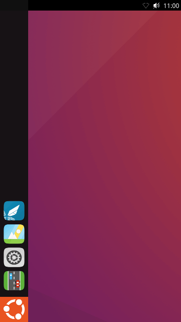
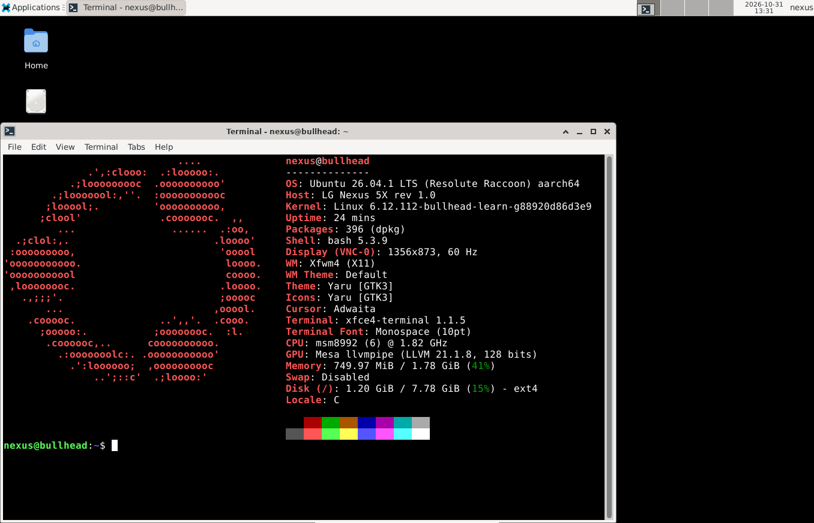
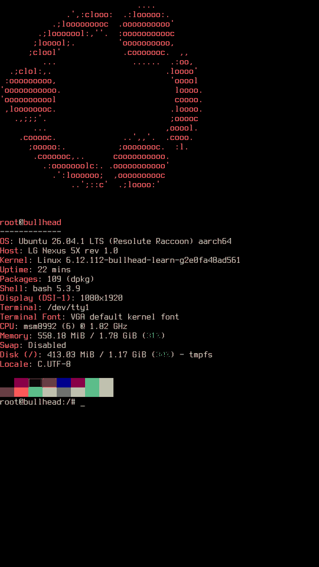
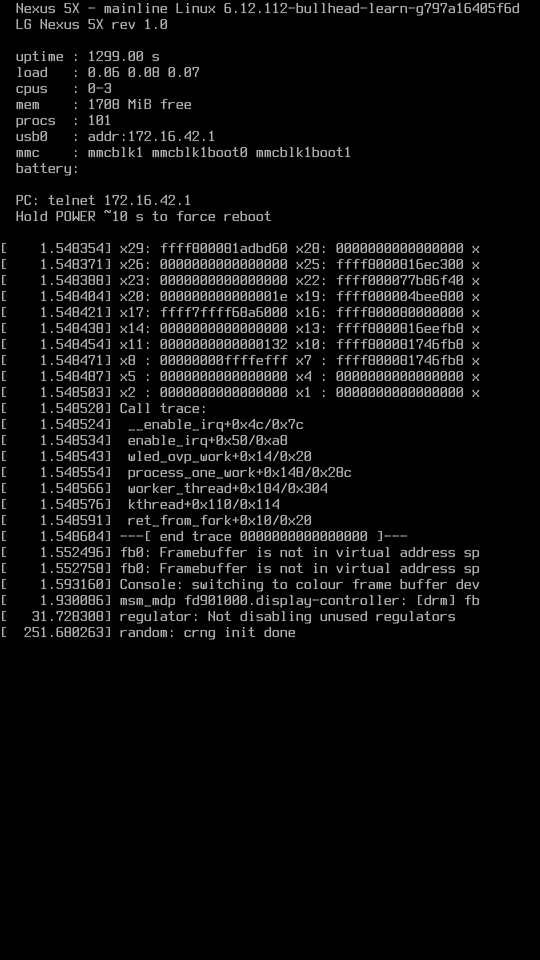
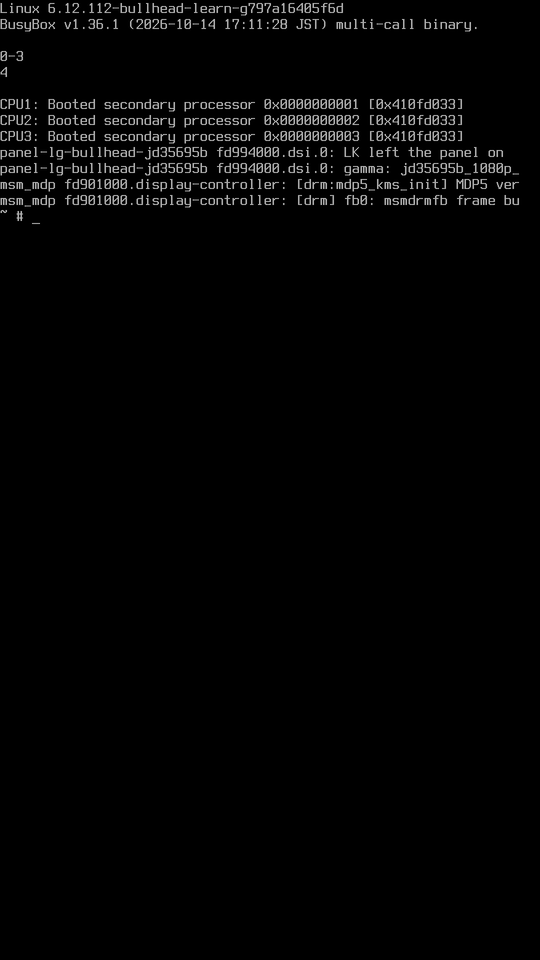
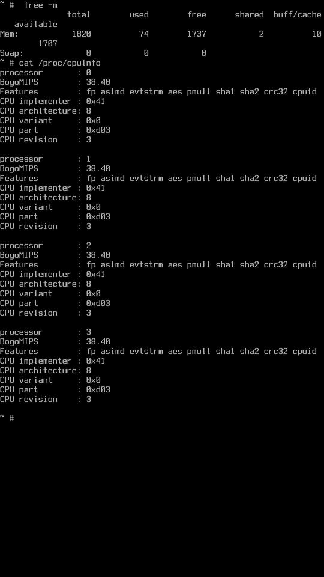
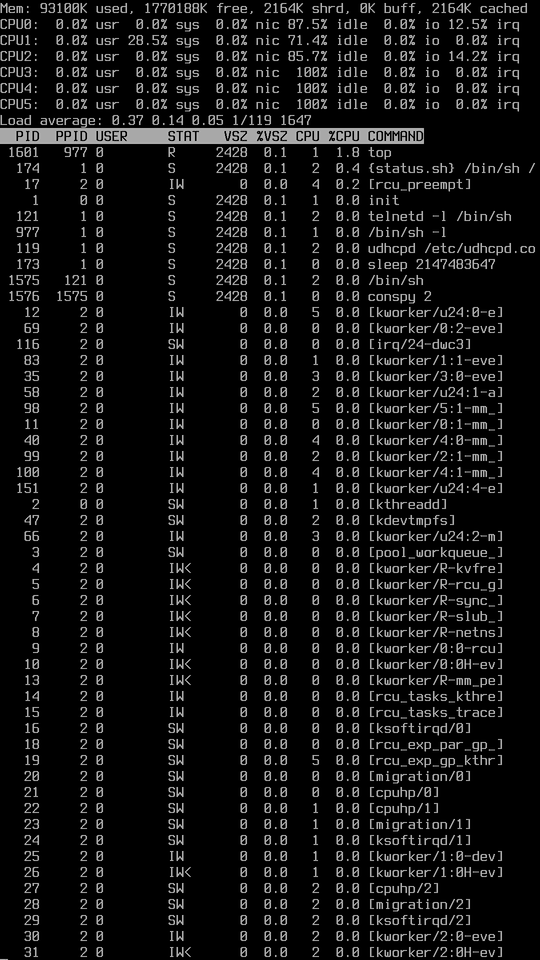
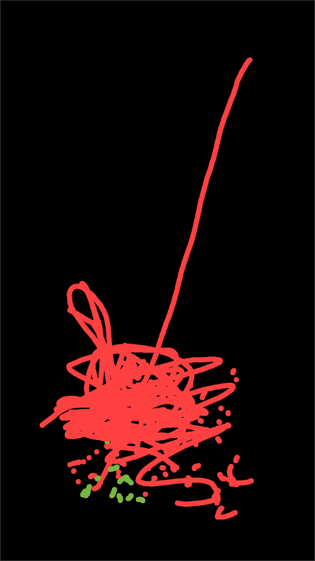

# Nexus 5X on Linux 6.12 + Ubuntu 26.04 LTS

> **Disclaimer.** This is an experiment: I'm trying out what Claude can do
> with an old phone. Most of the patches, device tree and text were written
> with Claude. They did boot on one Nexus 5X, but they may be
> wrong, unsafe or complete garbage. Nothing here has been reviewed by anyone
> who knows these drivers. Read it as notes from an experiment, not a reference,
> and use it at your own risk (`fastboot boot` only, never flash it).

> **Work in progress.** Display, touch, a USB keyboard and mouse, all 6 cores, CPU frequency scaling, Wi-Fi, the Adreno 418 GPU with Lomiri (Ubuntu Touch's shell) on the panel and an Ubuntu 26.04 desktop (shown on a PC over USB) work; much of the phone does not yet (see the table below).



*Lomiri on the Adreno 418: the indicator panel and Settings opening, recorded
from the panel in real time, with scripted touches
([how](#lomiri-on-the-panel)). The bands during animations are a rendering bug
that is on the panel too, not the recording.*



*Ubuntu 26.04.1 with XFCE running on the phone, shown in the PC's browser over
the USB cable ([how](#ubuntu-desktop-on-the-pc)).*

The LG Nexus 5X (bullhead, Snapdragon 808 / MSM8992) running a kernel.org
6.12 LTS kernel (plain upstream stable, not Android's ACK/GKI) with a static
BusyBox userspace. It has the real MDP5/DSI display driver, multitouch, USB
host for a keyboard, all 6 CPU cores and CPU frequency scaling up to the
stock 1.44/1.82 GHz. It boots to a BusyBox shell on the panel, and Ubuntu
26.04.1 LTS runs on top of it in RAM (`ubuntu-chroot`, see Build and boot),
or boots as the whole system with an XFCE desktop shown on a PC (see
[Ubuntu desktop on the PC](#ubuntu-desktop-on-the-pc)), or with Lomiri on
the panel, drawn by the GPU (see [Lomiri on the panel](#lomiri-on-the-panel)).
Nothing gets flashed: `fastboot boot` loads it into RAM, and a reboot goes
back to whatever is installed.

| Ubuntu 26.04.1 LTS (`fastfetch`) | Status screen (tty2) | BusyBox shell on the panel | `cat /proc/cpuinfo` | `top`, per-core view (`1`) | `touchtest`, two fingers |
|:---:|:---:|:---:|:---:|:---:|:---:|
|  |  |  |  |  |  |

The screenshots are copied straight from `/dev/fb0` on the phone (`cat /dev/fb0 | nc`).
The trace on the status screen is a harmless backlight-driver warning (see below).
Tested on a rev_1.0 board (LGH791, bootloader BHZ32c).

## What works and what doesn't

| | Part | Stock driver (Android 3.10) | Driver here (6.12) | Patches | Notes |
|---|---|---|---|---|---|
| ✅ | Boot with `fastboot boot` (RAM only) | LK, Android boot image | Same LK; boot image from `scripts/mkbootimg.py` | — | Image 27 MiB, under the bootloader's ~29.5 MiB limit |
| ✅ | 4 × Cortex-A53 (CPU0-3) | `cpu_ops.c` (`qcom,8994-arm-cortex-acc`), `clock-cpu-8994`, `qcom-cpufreq` | New `smp_qcom_acc` enable method, new `clk-cpu-8992`, mainline `cpufreq-dt` | [0001](patches/0001-firmware-qcom-scm-cold-boot-address-in-AArch64-state.patch)\*, [0003](patches/0003-arm64-smp-qcom-8994-arm-cortex-acc-enable-method-no-.patch)\*, [0011](patches/0011-clk-qcom-add-MSM8992-CPU-cluster-clocks.patch) | 384-1440 MHz (stock speed bin 1 table), schedutil |
| ✅ | 2 × Cortex-A57 (CPU4-5) | `cpu_ops.c` (`qcom,8994-arm-cortex-acc`), `clock-cpu-8994`, `qcom-cpufreq` | New `smp_qcom_acc` enable method, new `clk-cpu-8992`, mainline `cpufreq-dt`; mainline `cpufeature` with a late-CPU option | [0001](patches/0001-firmware-qcom-scm-cold-boot-address-in-AArch64-state.patch)\*, [0003](patches/0003-arm64-smp-qcom-8994-arm-cortex-acc-enable-method-no-.patch)\*, [0008](patches/0008-arm64-smp-qcom-ACC-set-the-A57-cluster-clock-before-.patch), [0009](patches/0009-arm64-cpufeature-optionally-accept-late-CPUs-with-ex.patch)\*, [0011](patches/0011-clk-qcom-add-MSM8992-CPU-cluster-clocks.patch) | 384-1824 MHz (stock speed bin 0 table), schedutil. They join late with `arm64.late_cpu_conflicts=warn`, so they run without their Spectre-v2 mitigation and A57 errata workarounds (832075 can rarely hang the CPU) |
| ✅ | Display: MDP5 1.10 + DSI + JD35695B panel driver | `mdss` fbdev (`mdss_fb`, `mdss_dsi`, `mdss-pll`), panel from `dsi-panel-jd35695b-1080p-cmd.dtsi` | Mainline `drm/msm` (MDP5, DSI, 20nm PHY), new `panel-lg-bullhead-jd35695b` | [0002](patches/0002-clk-qcom-mmcc-msm8994-keep-the-MDSS-GDSC-on.patch)\*, [0004](patches/0004-drm-msm-dsi-20nm-PHY-keep-the-PHY-and-PLL-LK-left-ru.patch)\*, [0005](patches/0005-drm-msm-dsi-MSM8992-DSI-host-and-20nm-PHY-addresses.patch), [0006](patches/0006-drm-msm-mdp5-add-the-MSM8992-MDP-1.10-configuration.patch), [0007](patches/0007-drm-panel-add-the-LG-Nexus-5X-JD35695B-command-mode-.patch) | Framebuffer console with a 16×32 font (67×60 characters) |
| ✅ | Backlight (PMI8994 WLED) | `leds-qpnp-wled` | Mainline `qcom-wled`, DT only | — | Stock limits: 15 mA per string, 29.5 V OVP |
| ✅ | Touchscreen (Synaptics S3320, RMI4) | `synaptics_dsx` (`synaptics_i2c_rmi4`) | Mainline `rmi4_i2c`, DT only | — | Mainline `rmi4` over I2C, 10-finger multitouch on `/dev/input/event2`. `touchtest` on the phone paints what it reports |
| ✅ | USB network (NCM) + telnet | `dwc3-msm`, Android gadget (`android.c`) | Mainline `dwc3-qcom`, configfs NCM | — | `telnet 172.16.42.1`. `conspy 1` lets you type into the shell on the panel |
| ✅ | USB host: keyboard | `fusb301`, `qpnp-smbcharger` (OTG), `dwc3-msm` | New `fusb301`, new `qcom-pmi8994-otg`, mainline `dwc3` (xHCI) and `usbhid` | [0013](patches/0013-regulator-add-the-PMI8994-OTG-boost.patch), [0014](patches/0014-usb-misc-add-the-FUSB301-Type-C-CC-controller.patch) | A USB keyboard on a USB-C OTG adapter types into the shell on the panel (tty1; Alt+F2 shows the status screen). The FUSB301 switches the port to host and turns on 5 V; the PC's USB network comes back when it is plugged in again |
| ✅ | Ubuntu 26.04.1 LTS userspace | — | — | — | Ubuntu Base (arm64) unpacked into RAM and entered with `ubuntu-chroot`. `apt` works through a proxy on the PC, and an SSH server gives a full Ubuntu login from the PC. Gone after a reboot |
| ✅ | Ubuntu desktop on the PC | — | Mainline `nbd` for the root disk | — | Ubuntu with systemd as the whole system, its root disk a file on the PC (NBD over the USB network). XFCE runs in TigerVNC and shows in the PC's browser (noVNC). Software rendering |
| ⚠️ | Lomiri on the panel (Ubuntu Touch's shell) | — | Ubuntu 26.04's Lomiri 0.5 and Mir 2.25, unchanged, on the GPU above | — | Shell, indicator panel, Settings, Terminal, Morph browser and the on-screen keyboard run on the GPU. Not in the release disk, and started by hand, not at boot. Same bands during animations |
| ✅ | Wi-Fi (QCA6174 on PCIe) | `qcacld-2.0`, `cnss`, `msm_pcie` | Mainline `ath10k_pci`, mainline `pcie-qcom`, new `phy-qcom-pcie-msm8994` | [0015](patches/0015-clk-qcom-gcc-msm8994-PCIe0-pipe-clock-from-the-PHY.patch)\*, [0016](patches/0016-clk-qcom-gcc-msm8994-PCIe-PHY-pipe-resets.patch)\*, [0017](patches/0017-clk-qcom-gcc-msm8994-give-the-PCIe-aux-RCGs-a-parent.patch)\*, [0018](patches/0018-clk-qcom-gcc-msm8994-do-not-wait-for-the-PCIe-aux-br.patch)\*, [0019](patches/0019-phy-qcom-add-the-MSM8994-MSM8992-PCIe-PHY-20nm-QMP.patch), [0020](patches/0020-PCI-qcom-add-MSM8994-MSM8992.patch) | PCIe Gen 1 x1 link, mainline `ath10k` with linux-firmware's `firmware-6.bin`. Scans 2.4 and 5 GHz, WPA2, DHCP. The calibration comes from the phone's own vendor partition |
| ✅ | USB host: mouse | `fusb301`, `qpnp-smbcharger` (OTG), `dwc3-msm` | Same as the keyboard; mainline `usbhid` | [0013](patches/0013-regulator-add-the-PMI8994-OTG-boost.patch), [0014](patches/0014-usb-misc-add-the-FUSB301-Type-C-CC-controller.patch) | A USB mouse on the same adapter works like any USB HID device. `touchtest` shows a pointer and paints with the left button |
| ✅ | eMMC detected, pstore/ramoops, QEMU `virt` | `sdhci-msm`, `ramoops` | Mainline `sdhci-msm`, `ramoops` | — | eMMC is never written. Only the vendor partition is mounted, read-only, for the Wi-Fi calibration |
| ✅ | Temperature sensors (TSENS) | `msm8974-tsens` | Mainline `qcom-tsens` (v1) | [0010](patches/0010-thermal-drivers-qcom-tsens-add-MSM8992.patch) | 13 thermal zones in `/sys/class/thermal`, calibrated from the phone's fuses. Each shuts the phone down at 115 °C, the stock reset temperature |
| ✅ | CPU voltages (CPR open loop) | `cpr-regulator` | New `cpr-8992` (open loop only) | [0012](patches/0012-soc-qcom-add-MSM8992-CPR-open-loop-voltages.patch) | Per-speed voltages from the chip's own fuses, computed like 3.10's `cpr-regulator`, within the stock floor and ceiling. The MX memory rail is voted per speed, and the A53 rail stays high enough for the CCI |
| ⚠️ | Thermal throttling | `msm_thermal`, plus the `thermal-engine` daemon | Mainline thermal core, `step_wise` with cpufreq cooling, DT only | — | Configured with the stock limits from 3.10's `msm_thermal`: all CPUs slow down from 60 °C, the A57s are capped at 768 MHz from 100 °C. Not yet seen to trigger (load tests peak near 49 °C) |
| ✅ | Reboot, and reboot to fastboot | `msm-poweroff`, `qpnp-power-on` | Mainline `msm-poweroff`, `qcom-pon`, DT only | — | `reboot-to bootloader` on the phone, or `scripts/phone-boot.sh` from the PC, gets to LK's fastboot with no buttons |
| ⚠️ | Display on every boot | `rpm-smd` | Mainline `qcom_smd_rpm`, `qcom_smd-regulator`, `rpmpd` | — | About 1 boot in 6 the RPM (SMD) does not answer. Then there are no RPM regulators: the panel stays frozen on the bootloader's Google logo and cpufreq stays off (telnet still works). A `reboot` from such a boot can hang: hold Power, then Power + Volume down |
| ⚠️ | Boot-time `WARNING` from `wled_ovp_work` | `leds-qpnp-wled` | Mainline `qcom-wled` | — | An unbalanced `enable_irq`, because the bootloader leaves the backlight on. Cosmetic |
| ❌ | Closed-loop CPR, thermal core control | `cpr-regulator` (closed loop), `msm_thermal` core control | None | — | The CPR hardware loop that trims voltage below open loop (stock runs 1440 MHz at 1115 mV, here 1160 mV). The stock core offlining (LG: from 90 °C) has no mainline equivalent |
| ⚠️ | GPU (Adreno 418) | `kgsl`, `ocmem` | Mainline `drm/msm` (a4xx) and `ocmem`; Mesa freedreno with [one patch](patches-mesa/0001-freedreno-add-the-Adreno-418.patch) | [0021](patches/0021-drm-msm-a4xx-add-the-Adreno-418-MSM8992.patch), [0022](patches/0022-soc-qcom-ocmem-the-PSGSC_CTL-registers-are-4-bytes-a.patch), [0023](patches/0023-soc-qcom-ocmem-add-MSM8994-MSM8992.patch), [0024](patches/0024-drm-msm-msm.allow_vram_carveout-also-lets-users-subm.patch), [0025](patches/0025-drm-msm-the-shrinker-and-VRAM-carveout-objects.patch) | OpenGL ES 3.1: kmscube at 60 fps, glmark2 off-screen scores 191. Capped at 300 MHz (stock 600) until it has thermal limits. Tiled (GMEM) rendering draws garbage, so everything runs with `FD_MESA_DEBUG=sysmem`. Bands appear during animations |
| ❌ | IOMMU | `msm_iommu` (`qcom,msm-smmu-v1`) | None | — | Scanout and the GPU use a contiguous carveout instead. With no IOMMU, any program that can use the GPU can reach all of RAM |
| ❌ | Bluetooth, modem, audio, camera, sensors, battery/charging, RTC | `bluetooth-power` + UART, `pil-q6v5-mss`, ASoC `msm8994` + `wcd9330`, `msmb_camera`, `nanohub`, `qpnp-fg` + `qpnp-smbcharger`, `qpnp-rtc` | None | — | Not attempted |

\* from [oneplus2-mainline](https://github.com/luvingiane/oneplus2-mainline) (OnePlus 2, MSM8994). "Mainline" means the driver as it is in kernel.org 6.12; "DT only" means it needed only device tree nodes, no code change.

## The hacks it takes

Mainline already has a bullhead device tree, but on its own that only reaches
a shell on CPU0. These are the extra pieces:

1. **No PSCI in the firmware**, so mainline can't start the other cores.
   Patches 0001, 0003, 0008 and 0009 bring them up the 3.10 way instead (the
   `qcom,8994-arm-cortex-acc` method):
   * The cold-boot address is handed to TrustZone over SCM, in AArch64 state.
   * Each core's ACC power, clamps and reset are released.
   * For the A57s, the cluster L2 is powered up first. Their clock mux is set to
     GPLL0 (600 MHz) before that (0008), as 3.10's
     `cpu_clock_8994_init_a57_v2()` does; the bootloader leaves it on the
     19.2 MHz reference.
   * SCM isn't ready at `smp_init`, so CPU1-5 come online at `late_initcall`.
     The system's CPU capabilities were already decided by the A53s, so
     mainline would refuse the A57s. 0009 adds `arm64.late_cpu_conflicts=warn`
     to let them in without those mitigations. Starting the cores from
     `smp_init` instead (with an early SCM call) made the RPM link fail on
     every boot.
2. **No 20nm DSI PLL driver**, so the display PLL the bootloader (LK) left
   running is kept as it is:
   * 0002 keeps the MDSS power domain on.
   * 0004 stops the PHY from being reset.
   * The device tree describes the PLL outputs as fixed clocks: 148.684 MHz
     pixel, 111.513 MHz byte.
3. **The MSM8992 is not the MSM8994.**
   * 0005 adds the 8992's DSI and PHY addresses.
   * 0006 adds a configuration table for MDP 1.10, since mainline only knew 1.9.
4. **A panel driver** (0007) for the JD35695B command-mode panel:
   * L22/L25 supplies, the DW8768 ±5.5 V enables (GPIO 89/90) and reset (GPIO 78);
   * one of LK's three gamma tables, chosen from LK's command line;
   * the 3.10 init commands.
5. **No IOMMU**, so the display scans out of a contiguous carveout
   (`msm.vram=256m cma=320M`). It is that big because the GPU works from it
   too, window buffers included.
6. **Command line**: `clk_ignore_unused pd_ignore_unused regulator_ignore_unused`
   so nothing the bootloader set up gets switched off,
   `fbcon=font:TER16x32` so the console is readable on a 1080-pixel panel, and
   `arm64.late_cpu_conflicts=warn` for the A57s.
7. **Device tree values**: the WLED OVP comes from the PMI8994 table (29.5 V),
   and the DSI supplies (L2, L12, L28) come from the 3.10 dtsi.
8. **Size diet** (`scripts/kernel.config`): everything is built in, so the
   image fits the bootloader's load window. The only modules are Wi-Fi's
   (cfg80211, mac80211, ath10k), carried in the initramfs.
9. **TSENS** (0010): the 8992's sensor block is TSENS v1 with 16 sensors, 13 of
   them used. Its calibration fuses are decoded as in 3.10's
   `tsens_calib_8992_sensors()`.
10. **Reboot**: `qcom-pon` must be built in. Its child power-key driver sets
    the PMIC to reset, not power off, when the kernel releases PS_HOLD. LK reads
    the reboot reason in LG's own encoding (bits swapped, shifted by 1), so the
    DT sets `mode-bootloader = <0x10>` and `mode-recovery = <0x8>`. BusyBox's
    `reboot` can't pass a reason, so `tools/reboot-to` does.
11. **CPU clocks** (0011): no mainline driver, so a small one after 3.10's
    `clock-cpu-8994.c`. To change speed it parks the cluster on GPLL0
    (600 MHz) and reprograms the cluster PLL with the 3.10 lock sequence. It
    then selects the PLL directly (from 1209.6 MHz) or through its /2 or /4
    divider. The CCI clock is only read, through SCM like 3.10, and stays at
    the bootloader's 300 MHz.
12. **CPU voltages** (0012): the open-loop part of 3.10's `cpr-regulator`.
    It reads the speed bin, CPR fuse revision, ring-oscillator selects and
    fused per-corner voltages. It applies the version-map adjustments,
    interpolates between fuse corners and clamps to the stock floor/ceiling
    overrides. Then it writes the result into the CPU OPP tables and starts
    cpufreq-dt itself. The OPPs also vote the MX corner (`required-opps`),
    and the A53 rail never drops below the CCI's corner. Every value was
    checked against the stock driver's own log on the same phone.
    `dts/bullhead-cpr.dtsi` is generated from the 3.10 DT by
    `tools/cpr/gen-cpr-dtsi.py`.
13. **Touchscreen** (DT only): mainline's `rmi4` driver handles the S3320 on
    BLSP1 I2C2 at 0x20 (interrupt GPIO 22, supplies L22/L25, as in 3.10). The
    BAM DMA engines don't probe here, so the bus runs in PIO mode, as 3.10's
    `qcom,disable-dma` does. Mainline `rmi4` has no reset GPIO, so the pin
    state releases reset (GPIO 8 high).
14. **Drawing on a command-mode panel**: the panel only shows frames the
    display driver sends. Writes into an mmap'd `/dev/fb0` don't tell the
    msm driver anything changed, so `touchtest` writes the changed rows back
    through `write()`, which does.
15. **USB host** (0013, 0014): one USB-C port, managed by a Fairchild
    FUSB301 CC controller that mainline has no driver for.
    * 0014 is a cut-down port of 3.10's driver. A sink on CC (keyboard,
      mouse, OTG adapter) turns VBUS on and switches dwc3 to host; a PC or
      charger switches it back to device. It never turns VBUS on while VBUS
      is already present.
    * 0013 is that VBUS: the PMI8994 charger's OTG boost, with 3.10's exact
      register sequence.
    * dwc3 is dual-role, peripheral by default, so the PC link works without
      them too. `rcS` rebinds the USB gadget when device mode comes back.
16. **BusyBox `conspy` on arm64** (`patches-busybox/`): it reads
    `KDGKBMODE` into a `long`, but the kernel writes an `int`. On 64-bit the
    upper half is stack garbage, so `conspy` sometimes decides the console is
    in scan-code mode and silently drops every key. It worked from telnet
    and failed over SSH. `scripts/build-busybox.sh` applies the fix.
17. **No RTC driver yet**: the phone starts in 1970, and `apt` rejects
    Release files from the "future". `ubuntu-on-phone.sh` sets the clock from
    the PC, and the Ubuntu boot asks `usb-proxy.py` for it.
18. **Wi-Fi** (0015-0020): mainline has no MSM8994 PCIe. 0015-0018 fix
    GCC's PCIe clocks and resets, 0019 is the 20nm PCIe PHY, and 0020 adds
    the controller. The PHY only locks with bullhead's `qcom,vbg-opt`
    bandgap trims from 3.10, and the DBI base must stay at 0 (upstream's CPU
    address hangs the bus). The chip's calibration (`bdwlan30.bin`) is a
    vendor file, so it is copied at boot from the phone's own vendor partition.
19. **GPU** (0021-0025, `dts/bullhead-gpu.dtsi`, `patches-mesa/`): mainline
    knows the A405, A420 and A430, not the A418.
    * 0021 adds it from the 3.10 `kgsl` values: chip 0x04010800, 512K of GMEM,
      the A420 microcode (`scripts/fetch-sources.sh`) and A430-style setup. It
      attaches both power domains and does TrustZone's SMMU setup.
    * 0022, 0023: OCMEM's `PSGSC_CTL` registers are 4 bytes apart, and the
      8992 has 4 regions. TrustZone refuses the OCMEM lock for graphics, so,
      like 3.10, it isn't locked.
    * 0024: `msm.allow_vram_carveout=1` also lets non-root programs submit,
      since Lomiri doesn't run as root. See the IOMMU row above for the cost.
    * 0025: the shrinker treated carveout objects as shmem, and the resulting
      oops in `kswapd` froze the phone.
    * The DT only has the 180 and 300 MHz points. The stock ones up to 600 MHz
      wait for GPU thermal limits.
    * Mesa is built as a GLVND vendor. An earlier build that replaced
      `libEGL.so.1` crashed Qt 6 apps on their first GL call.
20. **Lomiri** needed no patches, only configuration (`tools/lomiri/`):
    * Scale: qtmir gives a DSI panel an output scale of `GRID_UNIT_PX / 8`,
      Mir passes it on to Wayland clients, and Lomiri sizes windows in pixels,
      so apps drew about 3x too big. The output scale stays 1, and a changed
      `ShellScreen.qml` takes the shell's units from `GRID_UNIT_PX`.
    * Full-screen opaque apps were invisible: the shell's output has no usable
      depth buffer, so Qt's opaque pass drew the wallpaper over them.
      `QSG_NO_DEPTH_BUFFER=1` draws back to front.

Patches 0001-0004, 0009 and 0015-0018 come from
[oneplus2-mainline](https://github.com/luvingiane/oneplus2-mainline)
(OnePlus 2, MSM8994, GPL-2.0), and 0019 is adapted from its PHY driver. Each
value was checked against the Nexus 5X's own 3.10 kernel source. Patches
0005-0008, 0010-0014 and 0020-0025 are new.

## Ubuntu desktop on the PC

Ubuntu 26.04.1 with XFCE runs on the phone and shows in the PC's browser over
the USB cable. Nothing is flashed: the kernel boots from RAM, and Ubuntu's
disk is a file on the PC that the phone reads and writes over USB (NBD), so
keep the PC side running.

1. From the [releases](../../releases), get `nexus5x-ubuntu-desktop-*.tar`
   and `ubuntu-26.04-xfce-nexus5x.img.zst`. Unpack the tar and put the disk
   in its folder.
2. `sudo apt install fastboot adb qemu-utils zstd`. Unlocked bootloader;
   phone on USB in Android (USB debugging on) or fastboot.
3. `./nexus5x-desktop.sh`. The browser opens `http://172.16.42.1:6080`; the
   VNC password is shown on the phone's screen (or `./show-password.sh`).

Wi-Fi: `sudo nmtui` in the desktop's terminal. To build the disk yourself:
`tools/ubuntu/nbd-root.sh`, `nbd-install.sh`, `desktop-setup.sh`, then
`make-release-disk.sh` and `make-release.sh` for the release files.

## Lomiri on the panel

Lomiri, Ubuntu Touch's shell, runs on the phone's own screen, drawn by the
GPU. It isn't in the release disk yet, so it goes on a disk you built yourself
(see above), with the phone booted from `out/boot-ubuntu-rev-*.img`:

1. Build Mesa for the A418. On the phone, `apt-get install` the build packages
   (`meson`, `ninja-build`, `python3-mako` and Mesa's usual `-dev` packages).
   On the PC, put `mesa-26.0.3.tar.xz` in `downloads/mesa/` and run
   `tools/mesa/build-on-phone.sh`. It takes about 40 minutes and installs to
   `/opt/mesa-a418`, next to the system's Mesa.
2. On the phone, install the shell (about 230 MB):
   `apt-get install --no-install-recommends lomiri lomiri-desktop-session lomiri-greeter qtmir-desktop mir-platform-graphics-gbm-kms23 mir-platform-graphics-atomic-kms23 mir-platform-input-evdev10 lomiri-keyboard lomiri-keyboard-english maliit-inputcontext-qt5 maliit-inputcontext-qt6 lomiri-terminal-app lomiri-system-settings lomiri-indicator-network ayatana-indicator-session ayatana-indicator-datetime ayatana-indicator-power ayatana-indicator-sound morph-browser polkitd`
3. Put the files from `tools/lomiri/` in place; `tools/lomiri/README.txt` says
   where each goes. It needs a user `nexus` (uid 1000).
4. `systemctl start lomiri-phone`.

If `/dev/dri` only has `card0`, that boot hit the RPM problem in the table:
reboot and try again.

To record the demo at the top, with Lomiri on its home screen: build
`tools/fbgrab/fbrec.c` on the phone (`gcc -O2 -I/usr/include/libdrm fbrec.c -o /usr/local/bin/fbrec -ldrm`), install
`tools/demo/touch.py` as `/usr/local/bin/nexus-touch` and run
`tools/demo/demo-take.sh`. Then copy `/dev/shm/demo.rec` to the PC and run
`tools/fbgrab/rec2gif.py demo.rec demo.gif 480 15`.

## Build and boot

```sh
sudo apt install gcc-aarch64-linux-gnu qemu-system-arm bc flex bison libssl-dev
scripts/fetch-sources.sh       # Linux 6.12.112 + BusyBox 1.36.1 into downloads/, src/
scripts/build-kernel.sh        # applies patches/ onto a copy of the tarball, then builds
scripts/build-busybox.sh
scripts/build-initramfs.sh
scripts/build-bootimg.sh       # out/boot-rev-{10,101}.img and -keep.img variants

scripts/run-qemu.sh            # optional: the same kernel + initramfs on QEMU virt

fastboot getvar version-hardware   # rev_1.0 -> rev-10, rev_1.01 -> rev-101
fastboot boot out/boot-rev-10.img  # RAM only, nothing is written
telnet 172.16.42.1                 # PC side gets 172.16.42.2 over DHCP
```

* **Black panel?** Hold Power for 10 s and try `boot-rev-10-keep.img`, which
  keeps LK's panel state instead of re-initialising the panel.
* **Ubuntu on top:** with the phone booted and on the PC cable, run
  `tools/ubuntu/ubuntu-on-phone.sh`. It unpacks Ubuntu Base 26.04.1 (from
  `downloads/ubuntu/`) into a 1.2 GB tmpfs on the phone, starts
  `tools/ubuntu/usb-proxy.py` (an HTTP proxy for `apt`, listening only on
  the USB network) and sets the phone's clock. It also installs an SSH server
  with a key kept in `out/ssh`. Then `tools/ubuntu/ssh-phone.sh` logs in to
  Ubuntu, `tools/ubuntu/ssh-phone.sh screen` mirrors the panel, and
  `ubuntu-chroot` on the phone (or from the USB keyboard) enters it.
* **Getting back to fastboot:** `reboot-to bootloader` in telnet. Or run
  `scripts/phone-boot.sh [image]`: from this kernel, from Android (adb) or
  from fastboot, it gets to fastboot, boots the image and waits for the USB
  network.

## Layout

| Path | What it is |
|---|---|
| `patches/` | The 25 kernel patches above, applied by `scripts/prepare-kernel.sh` |
| `dts/` | Board files: mainline `msm8992-lg-bullhead`, `bullhead-smp.dtsi` (ACC for CPU1-5, A57 L2 and clock mux), `bullhead-display.dtsi` (MDSS, DSI, panel, WLED), `bullhead-thermal.dtsi` (QFPROM, TSENS, thermal zones), `bullhead-cpufreq.dtsi` (rails, CPU clocks, throttling), `bullhead-cpr.dtsi` (CPR nodes, OPP tables; generated), `bullhead-touch.dtsi` (I2C2, touchscreen), `bullhead-usb.dtsi` (FUSB301, OTG VBUS, dual-role dwc3), `bullhead-wifi.dtsi` (PCIe0, its PHY, the QCA6174's power), `bullhead-gpu.dtsi` (A418, OCMEM) |
| `scripts/kernel.config` | Options built into the kernel, plus the size diet |
| `rootfs/` | `/init` (mounts, then hands off to BusyBox init, or with `ubuntu=nbd` to Ubuntu via `ubuntu-nbd.sh`), `inittab` (shell on tty1, status screen on tty2), `rcS` (USB gadget, telnetd), `wlan-board.sh`, boot report |
| `scripts/mkbootimg.py` | A ~60-line Android boot image writer |
| `tools/gen-jd35695b-gamma.py` | Turns the 3.10 panel gamma tables into the driver's header |
| `tools/cpr/` | `cpr_open_loop.py` (the open-loop voltages from a fuse dump, to check against) and `gen-cpr-dtsi.py` |
| `tools/touchtest/` | `touchtest [seconds]`: paints each finger's path (and a USB mouse's, with a pointer) and logs input; c clears, q quits. Built into the initramfs as `/usr/bin/touchtest` |
| `tools/ubuntu/` | `ubuntu-on-phone.sh` (Ubuntu Base into RAM, clock, SSH), `usb-proxy.py` (apt's proxy and the clock on the PC), `ssh-phone.sh` (log in, or `screen` to mirror the panel); `ubuntu-chroot` is in the initramfs. Desktop: `nexus5x-desktop.sh` (all in one), `nbd-root.sh` (the disk), `nbd-install.sh`, `desktop-setup.sh`, `desktop-open.sh`, `show-password.sh`, `make-release-disk.sh`, `make-release.sh` |
| `patches-mesa/` | Mesa's A418 entry, applied by `tools/mesa/build-on-phone.sh` |
| `tools/mesa/` | `build-on-phone.sh` (Mesa on the phone, to `/opt/mesa-a418`), `env.sh` (run a program on it) |
| `tools/lomiri/` | Lomiri's service, GPU environment, device and display settings, and what each is for (`README.txt`) |
| `tools/fbgrab/` | `fbgrab.c` (a screenshot of what the panel shows), `fbrec.c` and `rec2gif.py` (a recording, then a GIF) |
| `tools/demo/` | `touch.py` (fake touches on the real touchscreen), `demo-take.sh` (the demo at the top) |
| `patches-busybox/` | BusyBox fixes, applied by `scripts/build-busybox.sh` |
| `tools/reboot-to/` | `reboot-to bootloader\|recovery`: reboot with a reason, built into the initramfs |
| `scripts/phone-boot.sh` | From wherever the phone is, to fastboot, then `fastboot boot` an image |

Kernel patches are GPL-2.0, like the kernel they apply to.
